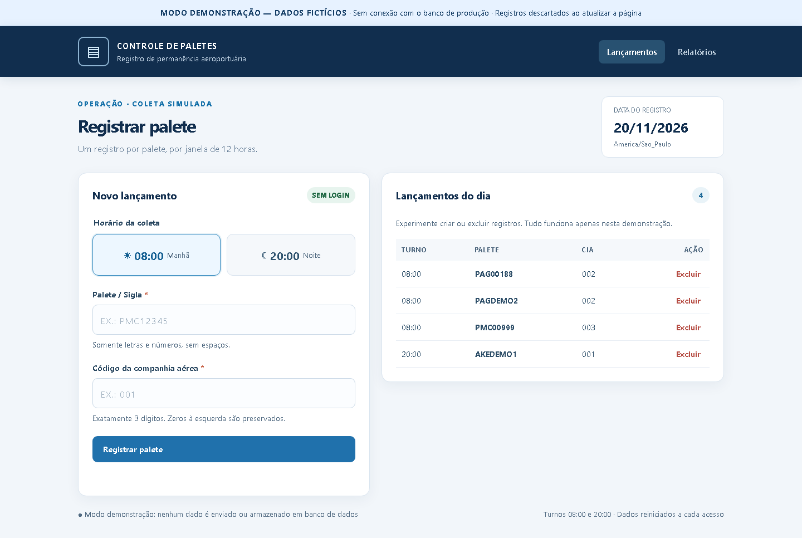
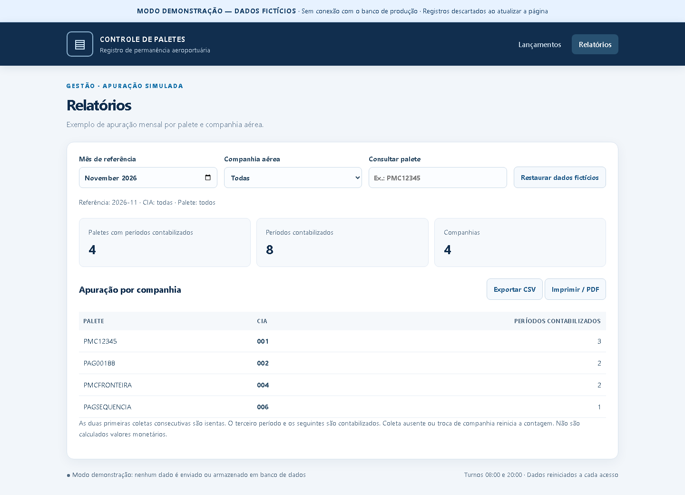

# Controle de Paletes Aeronáuticos

**Digitalização do registro e apuração da permanência de paletes.**

Um caso real de melhoria de processo operacional: transformar uma coleta manual em um fluxo digital que conecta o registro à conferência e à emissão de relatórios. Esta versão de portfólio permite experimentar o conceito com dados inteiramente fictícios.

**[Explorar demonstração interativa](https://brunogiacomelli1979-cyber.github.io/controle-paletes-demo/)**

## Problema identificado

A operação registrava os paletes manualmente e repassava as informações a outro setor. Esse setor precisava redigitar todos os registros em um sistema Microsoft Access, que calculava os períodos de permanência. Somente depois dessa etapa os relatórios eram emitidos.

O fluxo exigia duas entradas da mesma informação e criava uma etapa adicional de trabalho antes da apuração.

## Solução desenvolvida

O aplicativo digitaliza a coleta. Na versão real, os registros operacionais são enviados diretamente ao banco de dados. Com a eliminação da redigitação, o setor responsável passa a se concentrar na conferência e na emissão dos relatórios.

A demonstração reproduz a experiência de cadastro e apuração no navegador, de forma independente do ambiente operacional.

## Antes × Depois

| Etapa | Antes | Depois |
| --- | --- | --- |
| Registro | Anotação manual | Lançamento em interface web |
| Transferência | Repasse dos dados para outro setor | Informação registrada diretamente na origem |
| Digitação | Nova digitação no Microsoft Access | Registro único, sem redigitação |
| Apuração | Cálculo após a redigitação | Apuração automatizada a partir dos registros |
| Relatórios | Emissão após todas as etapas anteriores | Conferência e emissão a partir da consulta |

## Tela da aplicação

Capturas reais da demonstração executada em Chromium com Playwright, usando somente exemplos fictícios.

## Funcionalidades

- Cadastro por data de São Paulo e turnos de 08:00 e 20:00, com validação e bloqueio de duplicatas.
- Códigos de companhia com três dígitos, preservando zeros à esquerda.
- Conferência dos lançamentos do dia e exclusão de registros fictícios.
- Relatórios por mês, companhia e palete, com indicadores resumidos.
- Apuração de coletas consecutivas de 12 horas: as duas primeiras são isentas e a terceira e as seguintes são contabilizadas.
- Reinício da sequência após uma coleta ausente ou mudança de companhia; continuidade entre meses e anos.
- Exportação CSV e impressão ou salvamento como PDF pelo navegador.
- Interface adaptada para celular e navegação por teclado.

A demo não calcula valores monetários. A base inclui sequências curtas, períodos contabilizados, interrupções, trocas de companhia e um exemplo que atravessa o mês (`PMCFRONTEIRA`, CIA `004`).

## Benefícios operacionais

O projeto foi concebido para eliminar a redigitação, reduzir retrabalho, padronizar os registros, centralizar as informações, automatizar a apuração e facilitar a emissão de relatórios. Não há medição auditada de produtividade, horas economizadas ou redução de custos apresentada neste portfólio.

## Como experimentar

1. Abra a demonstração e cadastre um palete fictício, como `TESTE123`, com CIA `007`.
2. Escolha o turno e confira o lançamento na lista do dia.
3. Acesse **Relatórios**, explore os filtros e exporte o CSV ou use **Imprimir / PDF**.
4. Recarregue a página para reiniciar todos os exemplos. Também é possível restaurar a base na tela de relatórios.

Para uso local, abra `index.html` com os demais arquivos na mesma pasta. Não é necessário instalar dependências para utilizar a aplicação.

## Tecnologias utilizadas

HTML, CSS e JavaScript puro na demonstração, GitHub Pages para publicação e GitHub Actions com testes Node.js e Playwright/Chromium para validação. Sem backend ou bibliotecas carregadas pelo visitante.

A versão operacional utiliza uma aplicação web com processamento e banco de dados em nuvem. As configurações e integrações desse ambiente não fazem parte deste repositório.

## Segurança e privacidade

**MODO DEMONSTRAÇÃO — DADOS FICTÍCIOS.** Os dados ficam exclusivamente na memória da página e são reiniciados ao recarregar. Não há API, banco remoto, cookies da aplicação, localStorage ou sessionStorage. O navegador carrega apenas os arquivos estáticos da própria demonstração; nenhum registro é transmitido.

Não há acesso ao sistema de produção, credenciais operacionais, marca corporativa ou imagens da operação real. Uma política de segurança de conteúdo bloqueia conexões de dados. O ambiente original permanece separado e privado.

Consulte [como os testes são executados](TESTING.md) para reproduzir as verificações de funcionalidades e isolamento.

---

[Abra a demonstração](https://brunogiacomelli1979-cyber.github.io/controle-paletes-demo/) e conheça o projeto de portfólio sobre tecnologia aplicada à digitalização e melhoria de processos operacionais.

